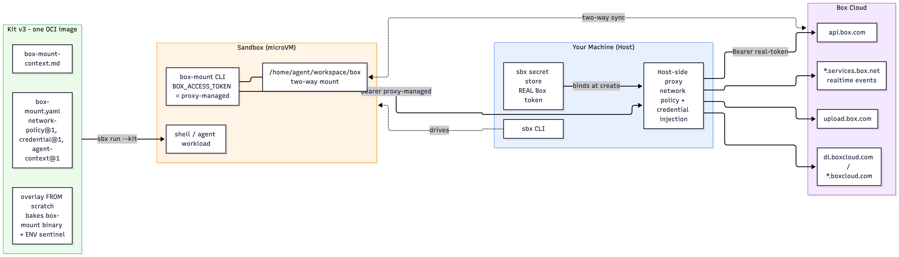
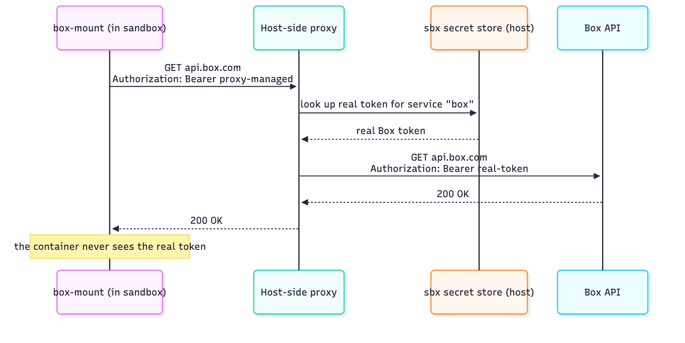

f# Build a Docker Sandboxes Kit: The Box Mount Kit 

> **Status**: A hands-on workshop. You'll build,
> run, verify, and publish a **Kit v3** that brings Box's **Box Mount** client
> into a Docker Sandbox - mounting a Box folder into an isolated microVM and
> keeping it in two-way sync, with the Box token injected by the sandbox proxy so
> the real token never enters the container.

This repo is **self-contained**: the v3 kit (`box-mount/`), the build/publish
script (`scripts/`), and this guide are everything you need. Clone it once and
run every command verbatim.

---

## What you'll need

- **macOS on Apple Silicon** or **Windows 11 (x86_64)** - the sbx runtime does not emulate, so your host arch is the sandbox arch.
- **Docker** with **`docker buildx`** (bundled with modern Docker Desktop. The daemon must be running to build the kit.
- The **`sbx` CLI** (we install it in Lab 2).
- A **Box developer token** (free, ~60 min lifetime - we get one in Lab 4). Box-team attendees can also use an OAuth access token.
- *(Optional)* the real **`box-mount` binary** from Box for live sync. **Don't have it yet?** A one-command mock (`scripts/stage-mock-binary.sh`) lets you complete every build/validate/compose step without it.

## What you'll learn

By the end you'll be able to:

- Explain how a Docker Sandbox isolates an agent and how its **proxy injects credentials** without leaking them
- Read and write a **Kit v3 descriptor** - the `network-policy@1`, `credential@1`, and `agent-context@1` capabilities
- Understand why a **v3 mixin carries its own overlay** (and how that removes the v2 `sbx template load` step)
- Stage a private binary into a kit **build context** and bake it into a `FROM scratch` overlay
- **Validate**, **build**, **run**, and **conformance-check** (`kit-tck`) a kit
- Prove the **security model**: the real Box token stays on the host; the container only ever sees a sentinel
- **Publish** the kit as a single OCI image to a private registry

---

## Architecture

The kit is **one OCI image** (descriptor + overlay with the baked `box-mount`
binary) that composes onto any v3 workload. At runtime the `box-mount` client
only ever sends a **sentinel** token; the **host-side proxy** swaps in the real
Box token - stored on the host, never in the container - on outbound requests to
allowlisted Box hosts, and keeps the mounted folder in two-way sync with Box.

<p align="center">
  
</p>

---

## Agenda (90 minutes)

| # | Lab | Time |
|---|-----|------|
| 1 | [How Docker Sandboxes and kits work](#lab-1--how-docker-sandboxes-and-kits-work) | 10 min |
| 2 | [Get the repo and install `sbx`](#lab-2--get-the-repo-and-install-sbx) | 10 min |
| 3 | [Anatomy of a Kit v3](#lab-3--anatomy-of-a-kit-v3) | 15 min |
| 4 | [Get a Box token and stage the client](#lab-4--get-a-box-token-and-stage-the-client) | 10 min |
| 5 | [Validate and build the kit](#lab-5--validate-and-build-the-kit) | 10 min |
| 6 | [Run it: compose the mixin onto a workload](#lab-6--run-it-compose-the-mixin-onto-a-workload) | 10 min |
| 7 | [Use Box Mount: two-way sync](#lab-7--use-box-mount-two-way-sync) | 10 min |
| 8 | [Verify the security model](#lab-8--verify-the-security-model) | 8 min |
| 9 | [Conformance-check with `kit-tck`](#lab-9--conformance-check-with-kit-tck) | 7 min |
| 10 | [Publish the kit](#lab-10--publish-the-kit) | 5 min |
| - | [Wrap-up & appendices](#wrap-up) | 5 min |

**Table of contents:** [Lab 1](#lab-1--how-docker-sandboxes-and-kits-work) · [Lab 2](#lab-2--get-the-repo-and-install-sbx) · [Lab 3](#lab-3--anatomy-of-a-kit-v3) · [Lab 4](#lab-4--get-a-box-token-and-stage-the-client) · [Lab 5](#lab-5--validate-and-build-the-kit) · [Lab 6](#lab-6--run-it-compose-the-mixin-onto-a-workload) · [Lab 7](#lab-7--use-box-mount-two-way-sync) · [Lab 8](#lab-8--verify-the-security-model) · [Lab 9](#lab-9--conformance-check-with-kit-tck) · [Lab 10](#lab-10--publish-the-kit) · [Appendix A](#appendix-a-capability-reference) · [Appendix B](#appendix-b-cli-quick-reference) · [Appendix C](#appendix-c-troubleshooting)

---

## Lab 1 - How Docker Sandboxes and kits work

*(~10 min - concepts, no commands)*

**Docker Sandboxes** (`sbx`) run an AI agent - or a plain shell - inside a
lightweight **microVM**: its own Linux kernel, its own private Docker daemon, and
your workspace directory live-mounted in. Everything the agent does is contained;
nothing escapes to your host, your other containers, or any network destination
you haven't explicitly allowed.

All outbound HTTP/HTTPS traffic leaves the VM through a **host-side proxy**. The
proxy does two jobs that matter for this workshop:

1. **Network policy** - it only lets the VM reach hosts you've allowed.
2. **Credential injection** - it rewrites outgoing request headers to add a real
   secret that lives on the host. The agent sends a placeholder; the proxy swaps
   in the real value on the wire. **The container never sees the real token.**

Here is that token swap as a single request - the agent sends a sentinel, the
proxy substitutes the real token on the wire, and the response comes back, all
without the real token ever entering the sandbox:

<p align="center">
  
</p>

### What a *kit* is

A **kit** packages a capability and layers it onto a sandbox. There are two kinds:

- **Workload** - the thing the sandbox runs (e.g. `docker/sbx-kit-shell`, a Claude agent).
- **Mixin** - adds a capability *onto* a workload. **Box Mount is a mixin.**

### Why Kit v3 (and why this kit ships its own binary)

The previous schema (v2) could declare policy and credentials but a mixin could
**carry no content** - kit file injection is capped at ~4 MB and the `box-mount`
binary is ~20-34 MB. So v2 baked the binary into a *separate* prebuilt image you
had to `sbx template load` first, then composed the mixin onto it.

**Kit v3 lifts that limit:** a mixin carries its **own overlay**. The binary ships
*inside the kit*, so the kit is **one OCI image** that composes onto **any** v3
workload - no separate image, no `sbx template load`. That is the whole point of
the migration, and it's what this workshop builds.

| | v2 | **v3 (this kit)** |
|---|---|---|
| Kit is | a spec **+** a separately-built image | **one OCI image** (binary baked into the overlay) |
| Deliver binary | `build` → `sbx template load` | baked at build; **nothing to load** |
| Config | `permissions` / `credentials` / `environment` / `agentInstructions` | typed `capabilities[]` |
| Run | `sbx run shell --template … --kit ./ .` | `sbx run docker/sbx-kit-shell:1.0.0 --kit ./box-mount .` |

> **Checkpoint:** you can explain (a) what the proxy does with the Box token, and
> (b) why a v3 mixin can carry the binary but a v2 mixin could not.

---

## Lab 2 - Get the repo and install `sbx`

*(~10 min)*

### Step 1 - Clone this repo

```bash
git clone https://github.com/ajeetraina/sbx-kits-box-demo.git ~/sbx-kits-box-demo
cd ~/sbx-kits-box-demo
```

From here on, **all commands assume you're in `~/sbx-kits-box-demo`**.

Have a look around:

```bash
ls box-mount          # the Kit v3: descriptor, overlay recipe, agent context
ls scripts            # build/publish helper + optional mock-binary stager
```

### Step 2 - Install the `sbx` CLI

> Docker Desktop is **not** required to *run* `sbx` - but you **do** need a Docker
> daemon with `buildx` to *build* this kit. Docker Desktop or Rancher Desktop both work.

**macOS (Apple Silicon):**

```bash
brew install docker/tap/sbx
```

**Windows 11 (x86_64)** - enable the hypervisor (elevated PowerShell, restart when prompted), then install:

```powershell
Enable-WindowsOptionalFeature -Online -FeatureName HypervisorPlatform -All
winget install -h Docker.sbx
```

### Step 3 - Sign in and set a network policy

```bash
sbx login
```

On your **very first run** the daemon asks for a default network policy. Choose
**Balanced** (default-deny with common dev hosts allowed) - this kit adds the Box
hosts it needs on top, via its `network-policy@1` capability.

### Step 4 - Confirm the toolchain

```bash
sbx version                 # sbx CLI present
docker version              # the SERVER section must be present (daemon running)
docker buildx version       # buildx present (needed to build the kit)
```

> If `docker version` shows no **Server** section, start Docker/Rancher Desktop
> before continuing - the kit build fails silently if the daemon is down.

> **Checkpoint:** `sbx version`, `docker version` (Server present), and
> `docker buildx version` all succeed.

---

## Lab 3 - Anatomy of a Kit v3

*(~15 min - read the files you'll build)*

Open the three files in `box-mount/`. This is the entire kit.

### 3.1 The descriptor - `box-mount/box-mount.yaml`

The first line is special:

```yaml
# syntax=docker/sandbox-kit:3
```

That tells BuildKit to pull the **kit frontend**, which validates the descriptor
and assembles the kit. The header block declares what the kit *is*:

```yaml
schemaVersion: "3"
kind: mixin                       # adds a capability onto a workload
displayName: Box Mount (two-way folder sync)
version: "0.4.0"                  # == the box-mount client version it ships
```

Then **three typed capabilities**. Read each one in the file:

**1. `network-policy@1`** - the Box hosts the client is allowed to reach. v3 is
**phase-scoped**: these live under `runtime:` (the running agent), and an absent
phase grants nothing. Note the comment about `*` matching a **single** DNS label - that's why `*.realtime.services.box.net` is listed separately.

```yaml
- type: com.docker.sandbox/network-policy@1
  config:
    runtime:
      allow:
        - api.box.com
        - upload.box.com
        - dl.boxcloud.com
        - "*.boxcloud.com"
        - "*.services.box.net"
        - "*.realtime.services.box.net"
        - "*.boxcdn.net"
```

**2. `credential@1`** - the heart of the security model:

```yaml
- type: com.docker.sandbox/credential@1
  optional: true                  # sandbox still starts without a token
  config:
    service: box                  # matches `sbx secret set box`
    phase: runtime
    apiKey:
      name: BOX_ACCESS_TOKEN
      proxyManaged: true          # ← the real token stays on the host
      inject:                     # proxy adds this header on these hosts only
        - { domain: api.box.com,     header: Authorization, format: "Bearer %s" }
        - { domain: upload.box.com,  header: Authorization, format: "Bearer %s" }
        - { domain: dl.boxcloud.com, header: Authorization, format: "Bearer %s" }
```

`proxyManaged: true` is what keeps the real token out of the container. Every
`inject` domain **must** also appear in the same phase's `allow` list - all three
do.

**3. `agent-context@1`** - instructions handed to the agent, pulled from a file:

```yaml
- type: com.docker.sandbox/agent-context@1
  config:
    contentFile: ./box-mount-context.md
```

### 3.2 The overlay - `box-mount/box-mount.dockerfile`

This is what v3 adds over v2: a mixin's **own content**.

```dockerfile
FROM scratch                      # overlay only - no base, no ENTRYPOINT
ARG TARGETARCH                    # amd64 | arm64, set per-platform by buildx
COPY --chown=root:root --chmod=0755 bin/linux/${TARGETARCH}/box-mount /usr/local/bin/box-mount
COPY --chown=root:root --chmod=0755 bin/linux/${TARGETARCH}/box-mount /usr/local/bin/agent-mount
ENV BOX_ACCESS_TOKEN="proxy-managed"   # the sentinel the proxy rewrites
```

Three things to notice:

- `FROM scratch` - the overlay is *just* the binary + the `ENV`; it lands on top
  of whatever workload you compose it onto. There's **no ENTRYPOINT** - the
  workload keeps its own launch command.
- `${TARGETARCH}` picks the right binary per arch, so one build serves both.
- The binary is installed under **two** names: `box-mount` (required - its `mount`
  command self-invokes a `box-mount` helper on PATH) and `agent-mount` (alias).

### 3.3 The agent context - `box-mount/box-mount-context.md`

Plain instructions the agent reads: how to mount/status/unmount, and the rule that
auth is pre-wired through the proxy (so **don't** run `box-mount config`).

> **Checkpoint:** point to the one line that keeps the real token on the host
> (`proxyManaged: true`) and the one line that makes the kit arch-agnostic
> (`ARG TARGETARCH`).

---

## Lab 4 - Get a Box token and stage the client

*(~10 min)*

### Step 1 - Get a Box developer token

In the [Box Developer Console](https://app.box.com/developers/console), open (or
create) an app, then **Configuration → Generate Developer Token**. Copy it. It
lasts ~60 minutes - fine for this workshop; just regenerate if it expires.

> A developer token is the quickest path. An OAuth/JWT access token works too -
> this kit injects whatever access token you store as the `box` secret.

### Step 2 - Stage the `box-mount` binary

A kit's build context is **its own directory**, so the binary must live under
`box-mount/bin/linux/<arch>/`. These paths are git-ignored.

**If you have the real binary from Box** (the `box-mount-0.4.0-linux-<arch>.tar.gz` archives):

```bash
# arm64 (Apple Silicon)
mkdir -p box-mount/bin/linux/arm64
tar xzf /path/to/box-mount-0.4.0-linux-aarch64.tar.gz -C box-mount/bin/linux/arm64
chmod +x box-mount/bin/linux/arm64/box-mount
file box-mount/bin/linux/arm64/box-mount     # sanity: ELF … ARM aarch64

# amd64 (Intel / Windows)
mkdir -p box-mount/bin/linux/amd64
tar xzf /path/to/box-mount-0.4.0-linux-x86_64.tar.gz -C box-mount/bin/linux/amd64
chmod +x box-mount/bin/linux/amd64/box-mount
file box-mount/bin/linux/amd64/box-mount     # sanity: ELF … x86-64
```

**Don't have the real binary yet?** Stage the workshop mock so every build/validate
step still works (sync won't actually run):

```bash
./scripts/stage-mock-binary.sh
```

Either way, confirm your host's arch has a binary staged:

```bash
uname -m                                       # x86_64 → amd64 ; arm64 → arm64
ls box-mount/bin/linux/*/box-mount
```

> **Why both arches?** The sbx runtime does **not** emulate - the image arch must
> match your host. Staging both lets one build serve Apple Silicon and Intel alike.

> **Checkpoint:** `ls box-mount/bin/linux/*/box-mount` lists a binary for at least
> your host's arch, and you have a Box token on your clipboard.

---

## Lab 5 - Validate and build the kit

*(~10 min)*

### Step 1 - Fast descriptor validation

This runs the kit frontend over your descriptor and resolves the overlay **without
producing an image** - the quickest way to catch a schema or path error:

```bash
docker buildx build box-mount -f box-mount/box-mount.yaml --output type=cacheonly
```

A clean run means the descriptor is valid and the overlay recipe resolves. If you
see an error about a missing `bin/linux/<arch>/box-mount`, go back to Lab 4.

### Step 2 - Build the kit into an OCI layout

Now build the real artifact (binary baked in, descriptor attached) into a local OCI
layout - we'll conformance-check it in Lab 9. `PUSH=0` means build-only, no registry:

```bash
PUSH=0 ./scripts/push-kit.sh mynamespace
```

This writes `/tmp/sbx-kit-box-mount-layout`. The `mynamespace` argument is only
used to name the image tag here; nothing is pushed.

> **Single-arch, faster:** add `PLATFORMS=linux/arm64` (or `linux/amd64`) before the
> command to build just your host's arch.

> **Checkpoint:** both commands succeed and `/tmp/sbx-kit-box-mount-layout` exists.

---

## Lab 6 - Run it: compose the mixin onto a workload

*(~10 min)*

### Step 1 - Store the Box token as a secret (host-side)

The secret lives in your host keychain; the proxy injects it. The service name
`box` matches `service: box` in the descriptor:

```bash
echo "<paste-your-box-token>" | sbx secret set box
sbx secret ls                 # confirm a 'box' secret exists
```

> **Windows (PowerShell):** piping can mangle the token - run `sbx secret set box`
> with no pipe and paste it interactively instead.

### Step 2 - Compose the mixin onto a shell workload

You don't need to publish the kit to run it - point `--kit` at the local directory
and sbx builds it on demand and layers it onto a stock v3 shell workload:

```bash
sbx run docker/sbx-kit-shell:1.0.0 --kit ./box-mount .
```

> **Composing onto the Claude agent instead of a shell?** The same mixin layers
> onto any v3 workload - swap the shell kit for the Claude workload kit
> `docker/sbx-kit-claude:1.0.0` (note: it's `sbx-kit-claude`, **not** `sbx-claude`,
> and there is no `:latest` tag):
>
> ```bash
> sbx run docker/sbx-kit-claude:1.0.0 --kit ./box-mount .                              # local kit
> sbx run docker/sbx-kit-claude:1.0.0 --kit docker.io/<ns>/sbx-kit-box-mount:0.4.0 .   # from registry
> ```
>
> Claude Code then starts inside the sandbox with `box-mount` on PATH and the Box
> token injected by the proxy, exactly as below.

This drops you into a shell **inside the sandbox**, with `box-mount` on PATH. Try:

```bash
box-mount --version           # agent-mount --version works too (it's an alias)
```

> With the **real** binary you'll see `box-mount 0.4.0`. With the **mock** you'll
> see `0.4.0 (MOCK - workshop placeholder)` - enough to prove the kit composed
> correctly; real sync needs the real binary.

Leave this sandbox shell open for the next lab (or exit with `exit` / `Ctrl-D` and
reconnect later).

> **Checkpoint:** `box-mount --version` runs *inside* the sandbox - the kit
> successfully layered the binary onto the shell workload.

---

## Lab 7 - Use Box Mount: two-way sync

*(~10 min - needs the real binary and a valid token)*

> Using the **mock** binary? The commands below will print `MOCK: …` and not
> actually sync. Read along, then come back with the real binary for live sync.

Inside the sandbox shell, find a Box **folder id** - the number at the end of a
folder's URL on box.com (the root folder is `0`). Then:

```bash
# <local-dir>: absolute path to sync into   <box-id>: the folder id (root = 0)
box-mount mount "/home/agent/workspace/box" "<box-folder-id>"
box-mount status
```

**Down-sync** - the mount lists the Box folder's files:

```bash
ls /home/agent/workspace/box
```

**Up-sync** - a file created in the mount appears in Box within a few seconds:

```bash
echo "hello from the sandbox" > /home/agent/workspace/box/e2e.txt
# now check box.com (or the Box API) - e2e.txt should appear in that folder
```

Unmount when done:

```bash
box-mount unmount "/home/agent/workspace/box"
```

> **Do NOT run `box-mount config`** or write `~/.box-mount/box-config.json` - that
> starts an interactive OAuth/JWT handshake and flips the client out of the simple
> token mode the proxy relies on. Auth is already wired through the proxy.

> **Checkpoint:** a file you create in the mount shows up in Box (and vice-versa).

---

## Lab 8 - Verify the security model

*(~8 min - the payoff: prove the token never enters the container)*

Run each of these from your **host** terminal; `--` runs a single command inside a
fresh sandbox and exits.

**1. The binary is present and matches the runtime arch:**

```bash
sbx run docker/sbx-kit-shell:1.0.0 --kit ./box-mount -- box-mount --version
```

**2. The in-container env var holds the *sentinel*, not the real token:**

```bash
sbx run docker/sbx-kit-shell:1.0.0 --kit ./box-mount -- printenv BOX_ACCESS_TOKEN
# → proxy-managed
```

This is the proof: inside the sandbox, `BOX_ACCESS_TOKEN` is literally the string
`proxy-managed`. The real token never left your host keychain.

**3. Credential injection actually works** - a Box API call from inside the sandbox
returns `200`, because the proxy swapped the sentinel for your real token on the
wire (needs a valid `box` secret):

```bash
sbx run docker/sbx-kit-shell:1.0.0 --kit ./box-mount -- \
  curl -s -o /dev/null -w '%{http_code}\n' https://api.box.com/2.0/users/me
# → 200
```

**4. See what the sandbox reached (and what was blocked):**

```bash
sbx policy log            # or: sbx policy log <sandbox-name>
```

If a Box request gets blocked, this log shows the host - add it to the
`network-policy@1` `runtime.allow` list in the descriptor and rebuild.

> **Checkpoint:** step 2 prints `proxy-managed` **and** step 3 prints `200`. The
> container authenticated to Box without ever holding the real token.

---

## Lab 9 - Conformance-check with `kit-tck`

*(~7 min)*

`kit-tck` is the kit **conformance suite** - it checks your built artifact against
the v3 spec (descriptor shape, overlay ownership rules, declared version, etc.).
Run it against the OCI layout you built in Lab 5, passing the kit's version:

```bash
kit-tck validate --layout /tmp/sbx-kit-box-mount-layout 0.4.0
```

A passing run reports **✓ conforms**. Common things it catches:

- Overlay files not owned `0:0` or `1000:1000` (our `COPY --chown=root:root` satisfies this).
- A `version:` in the descriptor that doesn't match the `0.4.0` you pass here.
- Inject domains missing from the same phase's allow-list.

> If `kit-tck` isn't installed, this is the one tool you may need to obtain
> alongside `sbx`; skip this lab if it's unavailable and note it for follow-up.

> **Checkpoint:** `kit-tck validate … 0.4.0` reports the kit conforms.

---

## Lab 10 - Publish the kit

*(~5 min)*

A v3 kit is one OCI image - publishing is a single push. **But this image embeds
the private Box binary**, so the script refuses to push unless you explicitly
confirm the target repo is private:

```bash
# ⚠️ push ONLY to a PRIVATE repo - a public image would expose the Box binary
I_KNOW_THIS_IS_PRIVATE=1 ./scripts/push-kit.sh <your-namespace>
#   → docker.io/<your-namespace>/sbx-kit-box-mount  :latest + :0.4.0
```

Then anyone cleared for that repo composes the kit straight from the registry - no
clone, no local binary:

```bash
sbx run docker/sbx-kit-shell:1.0.0 --kit docker.io/<your-namespace>/sbx-kit-box-mount:0.4.0 .
```

> **Checkpoint:** the push prints `:latest` and `:0.4.0`, and you understand why
> the repo must be private.

---

## Wrap-up

You built a **Kit v3 mixin** from scratch: three typed capabilities, a `FROM
scratch` overlay that bakes a private binary per-arch, validated and
conformance-checked it, ran it by composing onto a stock shell workload, proved the
Box token never enters the container, and published it as a single OCI image.

**The three ideas to take away:**

1. **A v3 mixin carries its own overlay** - no separate image, no `sbx template load`.
2. **The proxy injects credentials** - the container holds a sentinel (`proxy-managed`); the real token stays on the host.
3. **Capabilities are typed and phase-scoped** - `network-policy@1` / `credential@1` / `agent-context@1`, each granting only what its phase declares.

**Where to go next:** adapt this kit for another Box client or service - change the
`allow` hosts, the `service:` name, and the baked binary. The pattern is the same.

---

## Appendix A: Capability reference

| Capability | What it declares | Key fields |
|---|---|---|
| `com.docker.sandbox/network-policy@1` | Hosts the sandbox may reach, per phase | `runtime.allow[]`, `install.allow[]` (absent phase ⇒ no access). `*` matches a **single** DNS label. |
| `com.docker.sandbox/credential@1` | A secret the proxy injects on outbound requests | `service` (matches `sbx secret set <service>`), `phase`, `apiKey.name`, `apiKey.proxyManaged`, `apiKey.inject[]` (`domain`/`header`/`format`). Entry-level `optional` and `description`. |
| `com.docker.sandbox/agent-context@1` | Instructions handed to the agent | `contentFile` (mixin) - the body is staged as a content layer. |

**Rules worth memorizing**

- Every `inject.domain` must also be in the **same phase's** `allow` list (exact host match).
- `proxyManaged: true` → the container env var holds a sentinel; the real secret stays on the host.
- v3 entries are **required by default**; add `optional: true` to let the sandbox start without the secret.
- Static env (like the `BOX_ACCESS_TOKEN` sentinel) rides in the overlay's `ENV`, not in the descriptor.

---

## Appendix B: CLI quick reference

```bash
# ── This kit ─────────────────────────────────────────────────────────────────
./scripts/stage-mock-binary.sh                    # optional: mock binary (no real sync)
docker buildx build box-mount -f box-mount/box-mount.yaml --output type=cacheonly   # validate descriptor
PUSH=0 ./scripts/push-kit.sh <ns>                 # build-only → /tmp/sbx-kit-box-mount-layout
kit-tck validate --layout /tmp/sbx-kit-box-mount-layout 0.4.0                        # conformance check
I_KNOW_THIS_IS_PRIVATE=1 ./scripts/push-kit.sh <ns>   # push (PRIVATE repo only)

# ── Run / compose ────────────────────────────────────────────────────────────
sbx run docker/sbx-kit-shell:1.0.0 --kit ./box-mount .            # compose local kit, interactive
sbx run docker/sbx-kit-shell:1.0.0 --kit ./box-mount -- <cmd>     # run one command, then exit
sbx run docker/sbx-kit-shell:1.0.0 --kit docker.io/<ns>/sbx-kit-box-mount:0.4.0 .   # from registry
sbx run docker/sbx-kit-claude:1.0.0 --kit ./box-mount .           # compose onto the Claude agent workload
sbx run docker/sbx-kit-claude:1.0.0 --kit docker.io/<ns>/sbx-kit-box-mount:0.4.0 .  # Claude workload, from registry

# ── Box Mount (inside the sandbox) ───────────────────────────────────────────
box-mount --version                               # (agent-mount is an alias)
box-mount mount "/home/agent/workspace/box" "<box-folder-id>"    # root folder = 0
box-mount status
box-mount unmount "/home/agent/workspace/box"

# ── Secrets & policy (host-side) ─────────────────────────────────────────────
echo "<box-token>" | sbx secret set box           # store the Box token (service: box)
sbx secret ls                                     # list stored secrets
sbx policy log [<sandbox>]                         # what the sandbox reached / what was blocked
sbx policy allow network <host>                    # allow an extra host

# ── Diagnostics ──────────────────────────────────────────────────────────────
sbx version ; docker version ; docker buildx version
uname -m                                           # host arch → which binary must be staged
sbx exec <sandbox> -- uname -m                     # sandbox runtime arch
```

---

## Appendix C: Troubleshooting

- **`no box-mount binary staged` / descriptor build fails on a missing `bin/linux/<arch>/box-mount`** - you haven't staged a binary for your arch. Run the real stage steps in Lab 4, or `./scripts/stage-mock-binary.sh`.

- **`FileNotFoundError: … 'box-mount'` on `mount`** - the v0.4.0 `mount` command self-invokes a `box-mount` helper on PATH. The overlay installs it under both `box-mount` and `agent-mount`; rebuild if you changed that.

- **`Cannot determine minimum Box Mount version allowed` (HTTP 403 from `cdn07.boxcdn.net`)** - the sync engine's version check hit a non-allowlisted host. `*.boxcdn.net` is in the `runtime.allow` list; if a new CDN host appears, add it and rebuild. Find blocked hosts with `sbx policy log <sandbox>`.

- **`403 Blocked by network policy` on mount** - the host the client reached isn't allowed. Find it with `sbx policy log <sandbox>` and add it to `network-policy@1 → runtime.allow` in `box-mount/box-mount.yaml`, then rebuild.

- **`401 Unauthorized` from Box** - the token is invalid/expired. Developer tokens last ~60 min and don't refresh under this kit. Get a fresh token, `echo … | sbx secret set box`, and **recreate the sandbox** (the proxy binds the secret at creation). To confirm it's the token (not injection), test host-side: `curl -H "Authorization: Bearer <token>" https://api.box.com/2.0/users/me` - a `200` means the token is good and you just need to recreate the sandbox.

- **`box-mount: not found` / exec format error** - arch mismatch; the runtime doesn't emulate. Check `uname -m` (host) vs the arch you staged, stage your host's arch, and rebuild.

- **`failed to create sandbox` / image has no variant for this host's arch** - same cause; build for your host's arch (`PLATFORMS=linux/<arch> …`) or stage both arches.

- **`500 … pull failed`** - the image isn't where sbx expects it. Usually Docker wasn't running during the build. Confirm `docker version` shows a Server section, rebuild, and retry.

- **`kit-tck` reports an overlay-ownership failure** - every file the overlay adds must be owned `0:0` or `1000:1000`. The `COPY --chown=root:root` lines satisfy this; don't drop the `--chown`.

- **Lost Box version history on save** - Box Mount doesn't support atomic-save (temp-file + rename). Edit files in place inside the mount.

---

*This workshop packages the `v3/box-mount` kit from
[ajeetraina/sbx-kits-box](https://github.com/ajeetraina/sbx-kits-box) as a
self-contained, v3-only lab. The `box-mount` binary is a Box private-preview
artifact and is not distributed here - obtain it from Box.*
